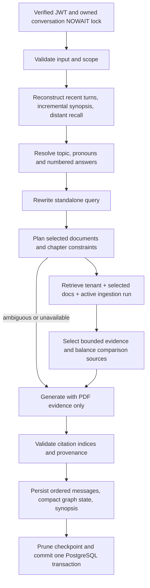

# Persistent conversational RAG

Explicit references such as “this PDF” bind to the authorized selected document
scope, rather than requiring an earlier conversational topic. General overview
requests sample bounded chunks from the opening, middle and final pages, with the
same tenant, active-run, content-policy and citation validation as ordinary search.
Responses identify this as an overview of selected excerpts, not an exhaustive
review. Specific-topic and chapter questions retain normal retrieval; an ambiguous
singular reference with multiple selected documents requests a document name.

Phase 3 extends the existing API, worker-independent chat service and Streamlit client.
There is no separate demo and no autonomous tool agent.

`ConversationState` carries user/conversation UUIDs, authorized document IDs, scope
version, current message, recent and recalled messages, bounded synopsis, active topic,
numbered references, rewritten query, retrieval plan, evidence, generation/citations,
fallback errors, estimated token budgets and timings. Every turn supplies a complete
fresh input; checkpoints never override authenticated SQL ownership or scope.

Retention: keep complete SQL messages until their owner deletes the conversation or
a source is deleted. Source deletion removes all derived messages, summary, topic,
references and checkpoint for every affected conversation, including multi-source
answers. Conversation shells survive for recovery; physical document cleanup remains
the durable Phase 2 worker job. Scope changes retain visible history with its scope
version but exclude old-scope turns from model context. Exported copies downloaded by
the user are outside server deletion control. Infrastructure backups need a separately
operated retention policy; this phase does not claim backup erasure.

Source associations retain an active flag after selection changes. Deletion checks
historical associations too, so changing scope cannot leave old PDF-derived messages
accessible after that PDF is deleted. Source deletion also resets the conversation
title to a neutral recovery title, rather than retaining potentially quoted source text.

Recent history defaults to 12 messages / 1800 estimated tokens. Older messages are
incrementally condensed in batches of up to 100 into an 800-token extractive synopsis.
Provenance records retained snippets' original positions; covered_through tracks the
high-water mark even when snippets are evicted. Refresh resets the synopsis and builds
the first bounded batch; subsequent turns advance it. PostgreSQL GIN full-text search
retrieves relevant distant messages (up to 6), with explicit first-question recall.
This is durable finite-context reconstruction, not unlimited model context. Search is
lexical and English reference heuristics have limits; ambiguous referents may need the
user to name a method. Optional Gemini rewriting improves language handling but is not
an authority on document contents.

Input budgets use cl100k estimates, not Gemini billing counts. Evidence and memory are
bounded separately; unusually large inputs exceeding the configured budget return 422.
Generation has a 2048 output-token provider cap and a secondary response size check.
Default rewriting and summary maintenance cost no model calls. Optional rewrite costs
one additional Gemini call on follow-ups. Memory, resolution, rewriting, retrieval and
generation elapsed milliseconds are saved as content-free turn metadata.

Strict grounding: all retrieval uses the selected scope, validated again for ownership,
readiness, index identity, active ingestion run and page bounds. Comparisons query each
selected source and require at least two evidenced documents. Exact selected filenames
can narrow retrieval; another `.pdf` name asks the user to select it. Chapter constraints
require matching extracted chapter headings/text; no chapter-to-page mapping is invented.
Citations include document, file, page/range, chunk, section, excerpt, content/asset ID and
an authenticated preview route. Citation numbers and scope are checked; automated claim
entailment verification is not yet implemented. Insufficient retrieval abstains.

Timeouts and exhausted provider retries return sanitized 503 and commit nothing.
Invalid citations return 502. Retry the same UUID after uncertain outcomes. A duplicate
UUID with different text returns 409. Same-thread concurrent requests return 409;
different conversations can proceed independently. SSE was considered: this phase
returns complete verified responses with processing indicators, not live token streaming.
This avoids publishing unverified citations or partial answers; reconnect using SQL
history and retry idempotently. Provider cancellation on browser disconnect is not
promised; a completed server transaction remains visible after reconnect.

See [ADR 0006](adr/0006-persistent-conversations.md) and the
[API/client guide](../setup/conversations.md).
