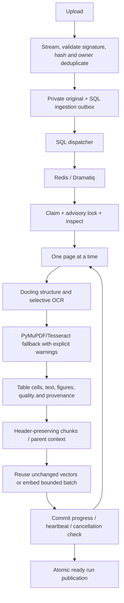
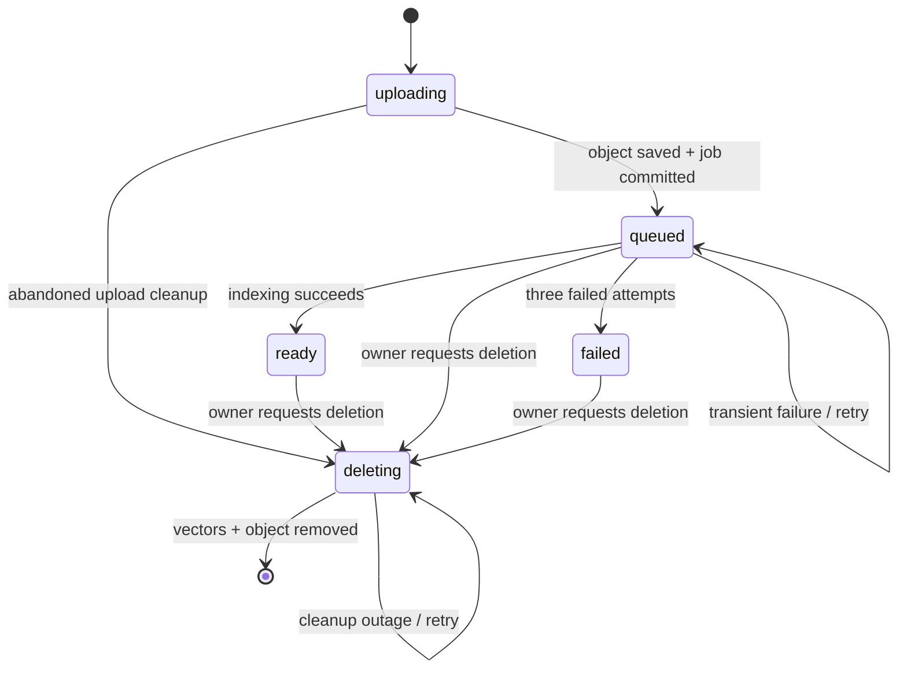

# Data flow and state transitions

Phase 2 current ingestion flow:

Job stages include queued, inspecting, extracting, normalizing, chunking, embedding,
publishing, completed, retry-wait, failed and cancelled. A run token scopes searchable
vectors; failed, cancelled and partially indexed documents never become ready. The
worker serializes deletion with in-flight extraction using a document advisory lock.
API deletion revokes access and removes derived chats immediately; its cleanup actor
removes originals, assets, page metadata and all known index content. SQL outbox rows
survive broker loss and worker restart. See ADR 0005 for current behavior.

The following numbered flow/state diagram records the original Phase 1 implementation;
its digital-only and polling limitations are superseded by the Phase 2 flow above.

1. Register: validate credentials → normalize email → hash → unique user insert.
2. Login: constant-work unknown-user password check → signed expiring JWT.
3. Upload: verify identity → bound bytes/type/signature → pending metadata and delayed
   compensation job → private S3 write → queue ingestion → return 202.
4. Worker: claim durable job → lease → lock document → read private PDF → extract
   digital text per page → recursive split (1200 chars, 180 overlap) → embed batches
   of 32 → deterministic tenant payload upsert → atomically mark ready and job succeeded.
5. Conversation: verify every selected document is owned and ready → persist association.
6. Ask: verify JWT/owner → lock conversation/documents → query embedding → filtered
   top six cosine hits (minimum 0.25) → trusted server-generated source metadata →
   Gemini evidence prompt → validate numbered references → atomic user/assistant messages.
7. UI: render returned text and citations, never raw HTML or untrusted executable content.
8. Delete: lock related conversations and document → remove derived chats → mark deleting
   and enqueue cleanup → worker removes vectors and S3 object → remove metadata/jobs.
9. Logout: increment token version; frontend clears its session; old tokens fail verification.

Job states: queued → running → succeeded; running → queued on retry; running → failed
after three ingestion failures. Running leases become claimable after ten minutes.
The `running` job state reports active processing; document status remains `queued`
until ready/failed, so UI never mistakes a partially indexed document for usable data.
Failed documents can be deleted and reuploaded; there is no retry endpoint yet.

No API key is sent to Streamlit/browser. Document chunks and questions leave the host
when sent to the configured embedding provider and Gemini. Users must choose providers
whose data handling terms fit their documents. Model answers are untrusted generated text.
