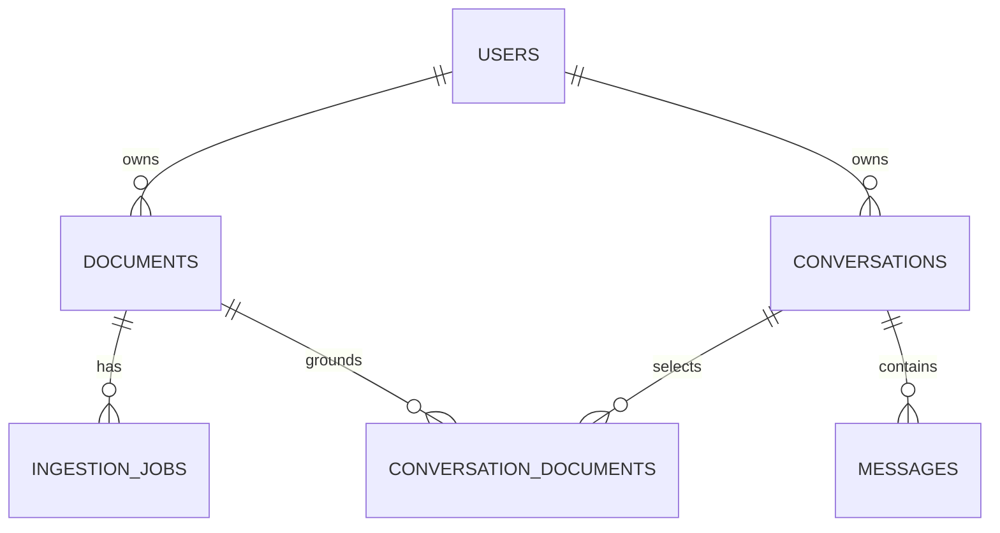

# Database design

PostgreSQL 17 is the production target. SQLAlchemy 2 UUIDs map to native PostgreSQL
UUID. Timezone-aware timestamps store UTC. SQLite is confined to isolated tests.
The baseline Alembic revision is `3f9e7d07d878`; runtime never calls `create_all`.

| Table | Fields and constraints |
| --- | --- |
| users | UUID PK, unique normalized email, Argon2 hash, token version, created_at |
| documents | UUID PK, indexed owner FK, filename, unique object key, indexed state, page count, safe error, created_at |
| ingestion_jobs | UUID PK, indexed document FK, kind, state, attempts, available_at, updated_at, safe error, created_at; compound claim index |
| conversations | UUID PK, indexed owner FK, bounded title, created_at |
| conversation_documents | compound PK (conversation_id, document_id), indexed reverse document lookup, both FKs |
| messages | UUID PK, indexed conversation FK, role, ordered position, text, JSON citations, request UUID, created_at; unique (conversation, request, role) and (conversation, position) |

All FKs cascade on delete. Deleting a document through the API explicitly deletes
affected conversations to remove derived text; cascading its association alone would
leave sensitive answers. There is no account deletion endpoint in this phase: raw SQL
user deletion is not a substitute for coordinated object/vector cleanup.

CHECK constraints enforce document/job states, job kinds and message roles. Message
positions are assigned under the conversation row lock, preserving order when two
timestamps are identical on lower-resolution clocks.

Owner equality across association edges is enforced by authenticated API transactions.
Use only application services for writes. PostgreSQL RLS and composite tenant FKs are
future defense-in-depth work. Transactions use database row locking, not Python locks.
Unique request IDs prevent retry duplication; job retries use deterministic vector IDs.
Qdrant payload stores `user_id`, `document_id`, `page`, `text`; user and document fields
have keyword indexes, with `is_tenant` on the user index. Changing embedding model or
dimension requires a new collection and re-ingestion, never mixing incompatible vectors.
