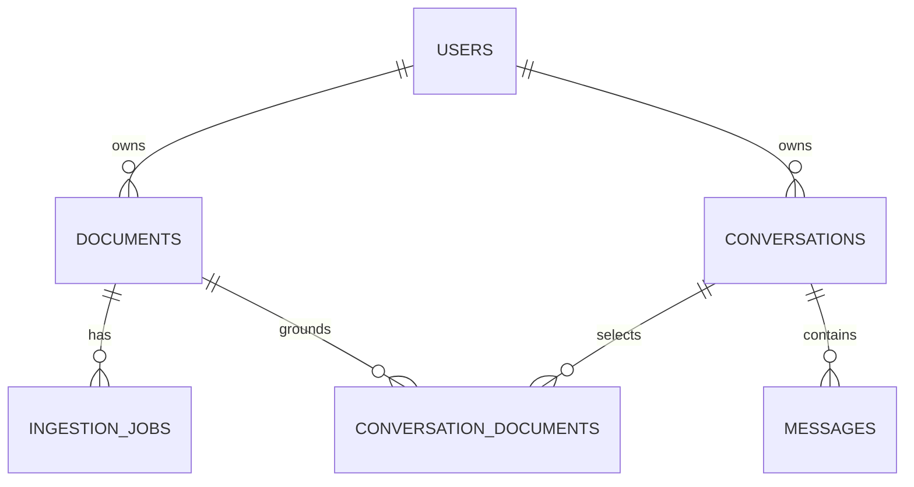

# Database design

Migration `20261106_retrieval` adds search_chunks (UUID point identity, owner/document
cascading foreign keys, active run, page/text/length/provenance) and search_terms
(chunk/term composite primary key, term frequency and inverted lookup index).
Statistics are computed only within owned ready selected active-run chunks. Row counts
must match published Document.chunk_count before a lexical index is considered complete.
Failed runs stay unavailable, and stale rows are removed at publication/deletion.
See ADR 0007 for backfill and storage/performance tradeoffs.

Phase 3 migration `20261106_conversations` adds conversation scope_version,
active_topic, bounded answer references and source_warning; messages gain JSON
turn_metadata containing scope version and content-free timing/budget flags.
`conversation_summaries` has a cascading conversation UUID primary key, covered_through
position, version, bounded content/provenance and updated_at. PostgreSQL adds a GIN
message-content full-text index for distant recall.

The official PostgresSaver owns checkpoints, checkpoint_blobs, checkpoint_writes and
checkpoint_migrations, initialized by bootstrap setup (not Alembic auto-create).
Thread names include server-owned user and conversation UUIDs. Access is exclusively
through authorized conversation operations; no public checkpoint endpoints exist.
Prune to the latest checkpoint after every turn. Back up these tables alongside
application data. Deletion explicitly clears thread tables in the same PostgreSQL
transaction; scope changes invalidate checkpoints and summary context.
See [transaction and retention details](conversations.md).

Migration `20261106_scope_provenance` adds `conversation_documents.active`. Scope
changes deactivate previous associations instead of removing their provenance. This
allows deleting a previously selected document to find and purge conversations that
still contain its historical answers. Active selection queries filter active=true;
privacy cleanup considers both active and historical associations. Clearing history
also removes obsolete inactive associations.

PostgreSQL 17 is the production target. SQLAlchemy 2 UUIDs map to native PostgreSQL
UUID. Timezone-aware timestamps store UTC. SQLite is confined to isolated tests.
The baseline Alembic revision is `3f9e7d07d878`; runtime never calls `create_all`.
Phase 2 adds revision `20261106_multimodal`: owner/hash/mode uniqueness, document
counts/index identity/active run, job stage/progress/lease delivery/cancellation fields,
`page_extractions` and `document_assets`. Existing rows receive safe migration defaults.
Both new tables reference documents with ON DELETE CASCADE; asset cleanup runs before
metadata deletion so physical content is never hidden from the cleanup worker.

| Table | Fields and constraints |
| --- | --- |
| users | UUID PK, unique normalized email, Argon2 hash, token version, created_at |
| documents | UUID PK, indexed owner FK, filename, unique object key, indexed state, page count, safe error, created_at |
| ingestion_jobs | UUID PK, indexed document FK, kind, state, attempts, available_at, updated_at, safe error, created_at; compound claim index |
| conversations | UUID PK, indexed owner FK, bounded title, created_at |
| conversation_documents | compound PK (conversation_id, document_id), indexed reverse document lookup, both FKs |
| messages | UUID PK, indexed conversation FK, role, ordered position, text, JSON citations, request UUID, created_at; unique (conversation, request, role) and (conversation, position) |

All FKs cascade on delete. Deleting a document through the API explicitly deletes
affected conversations to remove derived text; cascading its association alone would
leave sensitive answers. There is no account deletion endpoint in this phase: raw SQL
user deletion is not a substitute for coordinated object/vector cleanup.

CHECK constraints enforce document/job states, job kinds and message roles. Message
positions are assigned under the conversation row lock, preserving order when two
timestamps are identical on lower-resolution clocks.

Owner equality across association edges is enforced by authenticated API transactions.
Use only application services for writes. PostgreSQL RLS and composite tenant FKs are
future defense-in-depth work. Transactions use database row locking, not Python locks.
Unique request IDs prevent retry duplication; job retries use deterministic vector IDs.
Qdrant payload stores `user_id`, `document_id`, `page`, `text`; user and document fields
have keyword indexes, with `is_tenant` on the user index. Changing embedding model or
dimension requires a new collection and re-ingestion, never mixing incompatible vectors.
# Phase 5 security schema additions

Alembic revision `20261107_security` follows `20261106_retrieval`. It adds account
active/deleted state, document original/derived byte counters, refresh token hashes
with owner/family/absolute expiry/consumed/revoked timestamps, versioned content
inspection decisions and reason-only audit events. Refresh selectors are UUIDs, digests
are unique, and owner/family columns are indexed. No plaintext refresh credential is
stored. Existing accounts default active; existing byte counters start at zero and
are filled on reprocessing, so legacy storage quotas can undercount until reindexing.

Inspections are unique by document/object/stage/policy and use conflict-safe upserts.
Document deletion cascades inspections; account removal cascades tokens. Audit actors
use SET NULL on account removal and an indexed timestamp supports retention pruning.
Deleted owner tombstones survive until physical document cleanup finishes. See
[authentication](../security/authentication.md) and [retention](../security/data-retention.md).
