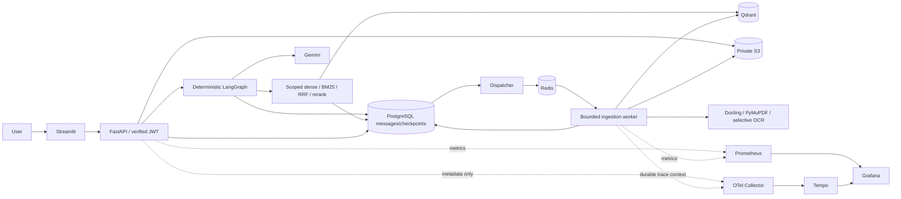

# Final architecture review

The repository contains the prerequisites, rather than just roadmap entries:
FastAPI versioned routes, Streamlit authenticated client, Argon2id/JWT/rotating
refresh sessions, ownership-filtered SQL models, Alembic migrations, Qdrant filters,
private S3 adapters, Redis/Dramatiq ingestion with a PostgreSQL outbox, structure-aware
PDF processing, PostgreSQL LangGraph checkpoints and separate durable messages.
`tests/test_conversations.py` exercises the overfitting follow-ups, restoration,
ordering, idempotency, document scope and deletion. `tests/test_security.py` exercises
session lifecycle, upload abuse, authorization and content/memory policy enforcement.
Retrieval alternatives and their measured limitations are in `evaluation/`.

Phase 6 keeps these boundaries and instruments their actual execution paths. API
contracts remain under `/api/v1`; operational endpoints are `/health/live`,
`/health/ready` and private `/metrics`. Errors retain the compatible `detail` field
and add a safe category, retryable flag and generated correlation ID. Streamlit
remains a REST client and never establishes authorization itself.

Deviations are intentional: local S3 uses SeaweedFS; the reranker is a bounded
documented lexical alternative rather than an unmeasured neural cross-encoder;
dense remains default because hybrid/reranking did not improve the synthetic held-out
results. Finite extractive summaries reconstruct context and never serve as PDF
evidence. Complete SQL history has no automatic age expiry; deletion/retention rules
must be chosen by the operator. Checkpoints keep the latest committed turn. The
legacy text parser and indexing entry points still support existing tests/imports;
they are not new parallel application pipelines. Historical migrations remain intact.

Ingestion jobs now carry nullable W3C trace context; absence of a trace does not block
recovery. Failed cleanup has a finite budget, inaccessible SQL state and an explicit
operator requeue command. Process heartbeats supplement job leases. Model outages
use bounded retries and safe errors; no success is fabricated after failed generation.
OTel export failures are isolated. Token/cost telemetry does not capture prompt text.

Remaining release boundaries include real hosted telemetry delivery, public TLS/cloud
deployment, notification routing, an independent security review and representative
human-reviewed evaluation. The readiness checklist records evidence, not promises.
