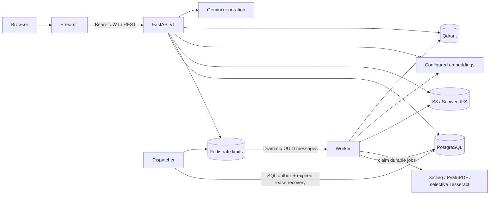

# System design

SmartRAG Pro is a modular monolith with an independently running ingestion worker.
Phase 2 extends ingestion as described in [ADR 0005](adr/0005-multimodal-ingestion.md)
and the [operation guide](../setup/phase2-ingestion.md). Phase 1 details below are
historical where superseded by that ADR: polling delivery is now Redis/Dramatiq plus
a SQL outbox dispatcher, digital-only parsing is now page-bounded multimodal parsing,
and retries, progress, previews and reindex control have versioned API endpoints.
FastAPI owns authorization and business transactions. Streamlit is an HTTP client;
its session state never determines access rights. Both API and worker reuse typed
configuration, models and RAG adapters.

## Boundaries

- `api/v1`: request validation, identity, HTTP status codes and resource ownership.
- `core`: fail-fast settings, Argon2id hashing, strict JWT verification and lifecycle.
- `db` / `models`: SQLAlchemy sessions, UUID entities, explicit Alembic migrations.
- `services`: S3/provider resources and atomic chat persistence. Direct SQLAlchemy
  queries are appropriate at this size; a generic repository layer would duplicate it.
- `rag`: bounded PDF extraction, page-preserving chunks and tenant-scoped vectors.
- `workers`: PostgreSQL job polling, leases, retries and compensating deletion.

## Authentication and security

Email is normalized using casefold; a database unique constraint resolves races.
Argon2id stores password hashes. JWT uses HS256 only and requires subject, token version,
JTI, issued-at, not-before, expiry, issuer and audience. Logout increments a database
token version and revokes all sessions for that account. Tokens last 30 minutes by default.

All resource access is scoped to the verified user. Unknown and foreign resources
return 404. No ownership field is accepted from clients. Qdrant retrieval combines
user ID and the conversation's ready document IDs; payloads are checked again before
use. Client filenames never become object paths. Uploads use random tenant/UUID keys.
S3 is private and no public download links are generated.

Redis limits peers to 20 auth and 120 other API requests per minute, failing closed
when unavailable. The Streamlit server shares one peer budget in this MVP; configure
an identity-aware gateway for larger deployments. Forwarded headers are not trusted.
Write requests require bounded Content-Length. Frontend caps uploads at 20 MB; API
enforces the same file limit. PDF signature is checked immediately; full parsing runs
in the separate worker. Encrypted, malformed, oversized, blank and scanned PDFs fail.

## API

Interactive specification: `/docs`; machine specification: `/openapi.json`.

| Resource | Operations |
| --- | --- |
| `/api/v1/auth/register`, `/login` | POST credentials, return user / token |
| `/api/v1/auth/me`, `/logout` | GET current user / POST revoke sessions |
| `/api/v1/documents` | POST multipart `file` (202), GET owned documents |
| `/api/v1/documents/{id}` | GET owned status, DELETE asynchronously (202) |
| `/api/v1/conversations` | POST title + ready `document_ids`, GET history |
| `/api/v1/conversations/{id}/messages` | GET history, POST `content` + UUID `request_id` |
| `/health/live`, `/health/ready` | Process liveness / dependency readiness |

List routes accept `limit` (1–100) and `offset` (nonnegative). Failed validation: 422;
missing or invalid authentication: 401; duplicate email: 409; foreign resource: 404;
oversize: 413; unsupported media: 415; rate limit: 429; dependency outage: 503.
Responses contain typed citations (source number, document UUID, filename, one-based
page, excerpt). Model responses with absent or invalid citation numbers fail with 502.
No evidence yields an explicit abstention without a model call.

## Failure and consistency model

Upload first persists an `uploading` record and delayed cleanup job. An object write
and metadata transition occur while the document row is locked; failure leaves a
durable compensation record. A cleanup job reclaims abandoned uploads after 10 minutes.
Workers claim jobs with `FOR UPDATE SKIP LOCKED`; a 10 minute lease permits recovery
after crashes. Document locks serialize indexing/deletion; deterministic point UUIDs
make repeated batches idempotent. Ingestion retries three times with bounded backoff.
Deletion retries indefinitely and remains inaccessible while pending.

Chat locks the conversation and ready document rows during retrieval/generation and
commits both messages atomically. Duplicate `request_id` returns the prior assistant
message. Provider errors persist neither half of an exchange. History is displayed
but not passed to the model in Phase 1; questions must be self-contained.

Deletion invalidates retrieval immediately, removes all conversations linked to the
source, and queues physical vector/object cleanup. Row locks serialize concurrent chat
and deletion. PostgreSQL is authoritative; a partial external write is never sufficient
to make a document retrievable. Backups require their own retention/deletion policy.

## Deployment limits

Compose binds only the UI/API to loopback. Datastores have no public host ports.
This is a production-oriented MVP, not a completed internet deployment. Before public
hosting add TLS, least-privilege per-service credentials, encryption at rest, tested
backups/restores, monitoring, email verification/reset, quotas and operational alerts.
PDF parsing needs container memory/CPU limits. No RLS, refresh tokens, OCR or HA yet.
Long model calls hold SQL locks; later load measurements should guide shortening them.
Prompt boundaries and citation validation mitigate but do not eliminate prompt injection
or hallucination. Do not treat generated text as executable instructions.
