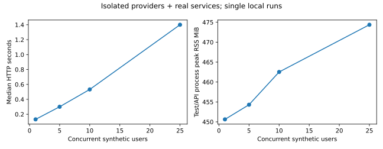

# Final engineering measurements

Generated by `uv run python -m evaluation.release_report` from committed public
synthetic measurements. Missing measurements are unavailable, never zero.

## Validation

| Run | Passed | Failed/errors | Skipped | Seconds |
|---|---:|---:|---:|---:|
| Native | 140 | 0 | 8 | 295.26 |
| Real disposable services | 148 | 0 | 0 | 578.50 |
| Isolated load | 4 | 0 | 0 | 59.11 |

## Retrieval comparison (historical Phase 4 evidence)

Ten synthetic source books, 60 authored page-chunks and 108 labeled queries.
The comparable held-out configurations below use 53 answerable questions.
Google `models/gemini-embedding-001`, 768 dimensions, index v1; cached real
embeddings are reused, so these are not new provider latency measurements.
Relevance is authored page-chunk membership. Recall@K is known relevant items
retrieved divided by all known relevant items; precision divides by K; hit rate
is any relevant hit. MRR uses first relevant rank; nDCG discounts ranked relevance.
These labels are synthetic and unreviewed. Validation selected dense; reranking
regressed. There is no comparable original production baseline or accuracy claim.

| Configuration | n | Recall@1 | Recall@3 | Recall@5 | Recall@10 | Precision@5 | Hit@5 | MRR | nDCG@5 |
|---|---:|---:|---:|---:|---:|---:|---:|---:|---:|
| bm25 | 53 | 0.6981 | 0.8774 | 0.9906 | 1.0000 | 0.2830 | 1.0000 | 0.9528 | 0.9302 |
| dense | 53 | 0.7736 | 0.9717 | 1.0000 | 1.0000 | 0.2868 | 1.0000 | 0.9906 | 0.9822 |
| rrf_0.5 | 53 | 0.7170 | 0.9811 | 1.0000 | 1.0000 | 0.2868 | 1.0000 | 0.9623 | 0.9657 |
| rrf_0.5_rerank | 53 | 0.7453 | 0.8962 | 0.9528 | 1.0000 | 0.2679 | 1.0000 | 0.9717 | 0.9306 |
| tfidf | 53 | 0.6415 | 0.9245 | 0.9906 | 1.0000 | 0.2830 | 1.0000 | 0.9214 | 0.9079 |

RRF .5 means equal lexical/dense reciprocal-rank shares, not raw-score averaging.
The optional reranker uses bounded term/bigram coverage and prior rank, not a
neural cross-encoder. Full metrics, bootstrap intervals, ablations and failures
remain in `evaluation/results/retrieval.json` and the earlier comparison report.

## Live provider acceptance

Real HTTP, PostgreSQL, worker, S3, Redis, Qdrant and Gemini; public generated PDFs.
Ingestion times include polling/queue wait and first-use effects; no cold/warm
classification is inferred from filename/order. Small samples do not support
reliable p95/p99. Figure checks verify OCR-visible labels, not advanced vision.

| Synthetic source | Pages | Chunks | Tables | Figures | Upload-to-ready seconds |
|---|---:|---:|---:|---:|---:|
| alpha-book.pdf | 1 | 1 | 0 | 0 | 71.190 |
| other-owner.pdf | 1 | 1 | 0 | 0 | 8.310 |
| beta-book.pdf | 1 | 1 | 0 | 0 | 10.280 |
| synthetic-research.pdf | 3 | 6 | 1 | 2 | 40.423 |
| mixed-poison.pdf | 2 | 1 | 0 | 0 | 10.988 |

Acceptance corpus: 5 public synthetic uploads, 8 pages and 10 published chunks. Quarantined content is excluded from published chunk counts.

5 live answer checks: 5 passed.
Mean HTTP whole-turn latency 4.783 s; median 5.171 s.
Question/word/citation assertions are reproducible proxies, not independently
reviewed semantic correctness. Full source-page attribution is in the JSON.

## Concurrent infrastructure experiment

Real disposable services, in-process ASGI clients, isolated 30 ms simulated
generator and 8-dimensional test embeddings. Four sequential turns per user.
No Gemini load, internet ingress, OCR concurrency or production capacity claim.
RSS/CPU refer to the test/API process, not total infrastructure. SQL test pool
uses SQLAlchemy defaults (5 plus 10 overflow); runtime defaults are 5 plus 5.
p95 is omitted below 20 samples and p99 below 100; single-run tails remain noisy.

| Concurrent users | Requests | Failures | Requests/s | p50 s | p95 s | p99 s | Peak RSS MiB | CPU s |
|---|---:|---:|---:|---:|---:|---:|---:|---:|
| 1 | 4 | 0 | 6.78 | 0.131 | unavailable | unavailable | 450.62 | 0.33 |
| 5 | 20 | 0 | 16.49 | 0.300 | 0.448 | unavailable | 454.30 | 1.34 |
| 10 | 40 | 0 | 18.08 | 0.533 | 0.698 | unavailable | 462.52 | 2.63 |
| 25 | 100 | 0 | 16.23 | 1.400 | 2.116 | 2.865 | 474.38 | 6.99 |

Container-visible hardware: 16 logical CPUs, 7.60 GiB RAM, Linux x86_64 (Docker Desktop).

## Answer quality, security and remaining measurements

Historical Gemini answer evidence contains 24 calls and provider-reported token
usage of 9970 total tokens. The earlier quality report
records phrase, context and citation proxies separately. Those measurements
do not establish human correctness or faithfulness. The current acceptance
run's per-call billing cost is unavailable; monitoring collects reported tokens
but no model price is invented. TTFT is unavailable because answers are not streamed.

The earlier isolated vectorizer experiment measured mean peak RSS of 195.82 MiB (TF-IDF) and 168.76 MiB (hashing). This is not total application RSS or a production memory improvement.

See `evaluation/security/policy-results.json` for deterministic adversarial cases,
the security reports for historical live failures, and `evaluation/release/` for
current live acceptance, monitoring, restart and PostgreSQL restore evidence.
No universal prompt-injection immunity or production disaster-recovery claim is made.

Unavailable: human-reviewed semantic evaluation, real-provider concurrent load,
hosted Langfuse delivery, public TLS/cloud endpoint, full object/vector restore,
production RPO/RTO, provider billing/cost calibration and target-host capacity.

## Operational metrics snapshot

Prometheus counters since the latest API process start, not an isolated
billing ledger or peak-memory measurement. Missing values remain unavailable.

| Metric | Measured value |
|---|---:|
| input_tokens_since_api_start | 1776.0 |
| output_tokens_since_api_start | 155.0 |
| api_process_rss_bytes | 322158592.0 |
| api_process_cpu_seconds | 20.35 |
| query_embedding_cache_hit_rate | 0.2 |
