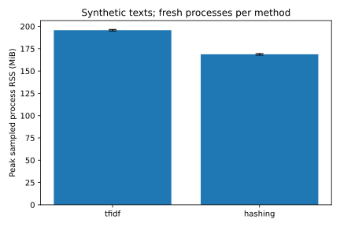
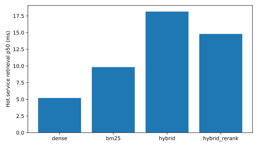

# Latency and memory

Actual measured values; no mocked provider timing.

Environment: `{'platform': 'Windows-11-10.0.26200-SP0', 'python': '3.12.5', 'logical_cpus': 16}`; physical memory `16849293312` bytes. Host CPU: 12th Gen Intel Core i5-12500H, verified with Win32_Processor; logical CPU count is recorded. Local Docker/services and host tests may contend for resources; these are development measurements, not SLAs.

Memory experiment: `{'tfidf': {'peak_rss_mib_mean': 195.81901041666666, 'peak_rss_mib_stdev': 0.8682279559704617, 'seconds_mean': 2.911115199996857}, 'hashing': {'peak_rss_mib_mean': 168.76432291666666, 'peak_rss_mib_stdev': 0.8984148547870763, 'seconds_mean': 3.900093966648759}}`. Each method uses fresh interpreter processes and the corpus size recorded in memory.json, concurrency=1 and RSS sampling every 10 ms. Baseline imports and corpus buffers are included in total RSS. Python tracemalloc and CSR bytes are also in memory.json. Hashing has fixed feature dimensionality (262,144), but CSR nonzeros, input text, caches and total process memory still grow. These results do not reproduce 700 MB to 60–80 MB or establish an application-wide memory reduction. The application uses persistent SQL BM25 rather than loading a vocabulary-sized lexical index per user.

Real document embedding throughput: the measured corpus in 6576.86 ms. Query-embedding distribution including rate-limit/backoff effects: `{'n': 108, 'mean': 465.03525925907996, 'p50': 459.62609999696724, 'p95': 500.4519999783952, 'p99': 556.1932999989949, 'stdev': 21.29431824403378}`. Embedding vectors are cached on disk for repeatable ranking experiments; warm replay makes no provider calls and is identified explicitly. Initial quota failure and cache-resume work are not counted as successful cold requests.

Real Gemini generation distribution (completed calls): `{'n': 24, 'mean': 2034.7917624991776, 'p50': 2103.8109000073746, 'p95': 3433.1426999997348, 'p99': None, 'stdev': 981.8635169791905}`. Token usage: `{'input_tokens': 9066, 'output_tokens': 904, 'total_tokens': 9970}`. List-price scenario estimate: `0.0049797999999999995` USD, with input/output rates `0.3` / `2.5` USD per million tokens. This is not an invoice and excludes embeddings, failed attempts, caching discounts and infrastructure; actual free-tier charges may differ. Rates were checked against [Google's model card](https://deepmind.google/models/model-cards/gemini-3-5-flash-lite/).

Time to first streamed token is null: the app does not stream tokens. No invented TTFT or whole-worker ingestion throughput is reported. Real bounded PDF extraction/chunking samples (excludes OCR, embeddings, storage and queue): `[{"repeat": 0, "pages": 60, "chunks": 90, "characters": 12262, "seconds": 2.615228400012711, "pages_per_second": 22.942546815302393, "final_rss_bytes": 175964160}, {"repeat": 1, "pages": 60, "chunks": 90, "characters": 12262, "seconds": 2.383224399993196, "pages_per_second": 25.175975875444752, "final_rss_bytes": 175968256}, {"repeat": 2, "pages": 60, "chunks": 90, "characters": 12262, "seconds": 1.9509212999837473, "pages_per_second": 30.754700356441774, "final_rss_bytes": 175972352}]`.

Actual PostgreSQL + Qdrant hot service retrieval: `{'dense': {'n': 108, 'mean': 13.288071405205065, 'p50': 5.197957012569532, 'p95': 48.08218500693329, 'p99': 50.6624239787925, 'stdev': 16.432859877714588}, 'bm25': {'n': 108, 'mean': 12.158067508641613, 'p50': 9.82352701248601, 'p95': 19.82630798011087, 'p99': 30.09671001927927, 'stdev': 12.587550394536189}, 'hybrid': {'n': 108, 'mean': 25.487089730126577, 'p50': 18.145747017115355, 'p95': 61.189050989924, 'p99': 72.29561900021508, 'stdev': 16.782157688183077}, 'hybrid_rerank': {'n': 108, 'mean': 22.56792295412635, 'p50': 14.794823015108705, 'p95': 56.362508999882266, 'p99': 60.338423994835466, 'stdev': 16.02998350515431}}`. Cold/warm real embedding-cache experiment: `[{'state': 'cold', 'milliseconds': 752.872932003811, 'hit': False}, {'state': 'warm', 'milliseconds': 0.04453299334272742, 'hit': True}]`. Cache hit rate during preloaded hot retrieval: `1.0`. This 100% hot hit rate is a controlled microbenchmark, not observed user traffic. CPU seconds `3.709999999999999`; peak sampled benchmark-process RSS `331120640` bytes. Per-query dense/lexical/fusion/rerank stages are in performance.json. These measurements exclude Gemini and HTTP/graph overhead; they are not whole-application end-to-end latency.

Empirical nearest-rank p50 is always shown; p95 only when n>=20, p99 only when n>=100. Small-sample tails are unstable. Memory bars show sample standard deviation, not confidence bounds. See methodology for limitations.

Live HTTP whole-application workflow: `{"status": "passed", "last_stage": "Gemini conversational turn 4", "synthetic": true, "observations": [{"stage": "full_ingestion", "seconds": 49.60899999999674, "pages": 4, "scope": "HTTP upload, storage, worker, embeddings, SQL/vector publication"}, {"stage": "whole_turn", "turn": 1, "seconds": 3.1719999999913853, "source_pages": [1]}, {"stage": "whole_turn", "turn": 2, "seconds": 1.5, "source_pages": [2]}, {"stage": "whole_turn", "turn": 3, "seconds": 1.2809999999881256, "source_pages": [3]}, {"stage": "whole_turn", "turn": 4, "seconds": 1.4690000000118744, "source_pages": [3]}]}`. This includes actual upload/storage/worker/embeddings and complete verified chat turns. Four turns do not support p95/p99 claims.

Service profile runs inside the Linux Docker test network. The separate native host-loopback server run has substantial network overhead and is not an algorithmic latency improvement comparison. Sequential mode order and resource contention can make a reranking sample appear faster than hybrid alone; no speed advantage of reranking is established.
