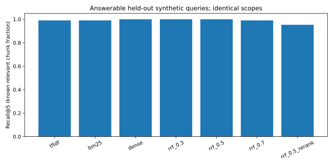

# Retrieval comparison

Generated from actual measurements; synthetic labels are not independently reviewed.

Dataset `b28675f4974f2179a9c4ff91c8ef00d4aea6be4b9d191c0356cb1a7aead0ba08`: {'documents': 10, 'chunks': 60, 'queries': 108}. Validation-only selection: `rrf_0.0`. Zero lexical share is equivalent to dense; production therefore retains dense as its default. The same answerable held-out queries and scopes are compared below.

| Method | n | Recall@1 | Recall@3 | Recall@5 | Recall@10 | Precision@5 | Hit@5 | MRR@10 | nDCG@5 |
|---|---:|---:|---:|---:|---:|---:|---:|---:|---:|
| tfidf | 53 | 0.6415 | 0.9245 | 0.9906 | 1.0000 | 0.2830 | 1.0000 | 0.9214 | 0.9079 |
| bm25 | 53 | 0.6981 | 0.8774 | 0.9906 | 1.0000 | 0.2830 | 1.0000 | 0.9528 | 0.9302 |
| dense | 53 | 0.7736 | 0.9717 | 1.0000 | 1.0000 | 0.2868 | 1.0000 | 0.9906 | 0.9822 |
| rrf_0.3 | 53 | 0.7736 | 0.9717 | 1.0000 | 1.0000 | 0.2868 | 1.0000 | 0.9906 | 0.9858 |
| rrf_0.5 | 53 | 0.7170 | 0.9811 | 1.0000 | 1.0000 | 0.2868 | 1.0000 | 0.9623 | 0.9657 |
| rrf_0.7 | 53 | 0.7170 | 0.9340 | 0.9906 | 1.0000 | 0.2830 | 1.0000 | 0.9623 | 0.9481 |
| rrf_0.5_rerank | 53 | 0.7453 | 0.8962 | 0.9528 | 1.0000 | 0.2679 | 1.0000 | 0.9717 | 0.9306 |

RRF weights are **lexical / dense**: 0.3 = 30/70; 0.7 = 70/30. Ranks are fused with k=60; raw BM25 and cosine values are never added. Validation uses separate topics/query IDs; held-out labels do not select weights.

The synthetic set has a ceiling effect: dense Recall@5 is at its ceiling on this corpus. This is not evidence of 100% real-world retrieval. Neither the 70/30 hypothesis nor the bounded lexical reranker improves this baseline; the reranker regresses Recall@5 and remains opt-in. No cross-encoder accuracy claim is made.

## Confidence and ablations

Dense Recall@5 95% query-bootstrap interval: [1.0, 1.0]; BM25: [0.9716981132075472, 1.0]. These are seeded IID-query bootstrap intervals, not guarantees for a new corpus; templates/topics are correlated.

Matched held-out follow-up subset (only these query IDs): `{'bm25': {'n': 6, 'recall5': 1.0, 'mrr': 0.75}, 'bm25_no_rewrite': {'n': 6, 'recall5': 1.0, 'mrr': 0.6111111111111112}}`. Do not compare this subset to the full-set aggregate. Near-duplicate removal made no ranking change on this corpus (one chunk per page); this does not establish its usefulness on overlapping real chunks. It stays disabled. Semantic chunking, multi-query LLM expansion, parent expansion and adaptive top-k were not adopted without a measured benefit; changing chunk units would also invalidate the current fixed-label comparison.

## Answer generation, separately measured

- `dense`: `{"n": 12, "citation_label_precision": 0.9, "citation_index_validity": 1.0, "citation_sentence_coverage_proxy": 0.7361111111111112, "context_precision": 0.23333333333333334, "context_recall": 1.0, "expected_phrase_recall_proxy": 0.7916666666666666, "unsupported_number_rate_proxy": 0.016666666666666666, "unanswerable_abstention_heuristic": 0.5}`
- `rrf_0.5_rerank`: `{"n": 12, "citation_label_precision": 0.9090909090909091, "citation_index_validity": 1.0, "citation_sentence_coverage_proxy": 0.7777777777777778, "context_precision": 0.21666666666666667, "context_recall": 0.95, "expected_phrase_recall_proxy": 0.7083333333333334, "unsupported_number_rate_proxy": 0.013888888888888888, "unanswerable_abstention_heuristic": 1}`

Model `gemini-3.5-flash-lite`; held-out questions per method (sample sizes listed above), actual live calls, no model doubles. Sampling uses provider-fixed defaults despite the requested temperature=0. The initial run had rate-limited attempts recorded in quality.json; those failures remain recorded and only failed cases were resumed with pacing. Citation-label precision measures labeled source relevance, not entailment. Sentence citation coverage, expected-phrase recall and numeric support are limited deterministic proxies. Human correctness/faithfulness/unsupported-claim scores remain null pending review. No judge model was used and no overall answer accuracy or hallucination rate is claimed.
