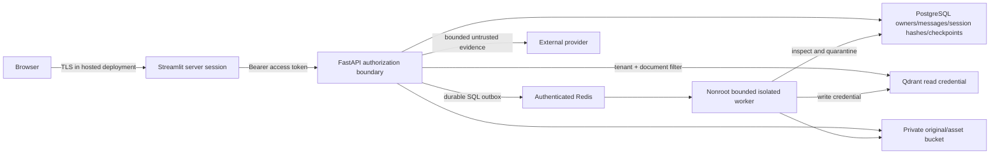

# SmartRAG Pro threat model

Scope: the existing modular monolith, Streamlit server, SQL outbox/Redis worker,
PostgreSQL/checkpoints, Qdrant, private S3 storage and outbound Gemini calls. Private
source text, images, embeddings, account identifiers, message history, passwords,
tokens, deployment credentials and model billing capacity are assets. An authenticated
tenant is still an adversary. A malicious PDF can be uploaded by its owner or supplied
to that owner by someone else. Model output and older generated memory are untrusted.

Trust boundaries: browser to Streamlit; Streamlit to API; API to storage; worker to
untrusted native PDF/OCR parsers; durable job ID to server-loaded ownership; private
content to an external provider; provider output to persistence/browser; operator to
bootstrap/migrations. No model has tools, shell access, URL-fetching capabilities,
credential access or authority to change scope. Administrative DB/storage access is
outside tenant authorization and must be protected by the operator.

| Attack | Component/asset | Risk | Implemented mitigation | Verification |
|---|---|---|---|---|
| Credential stuffing / expensive Argon requests | Auth | High | Shared IP and HMAC account rate limits; size limits; generic failures | Rate-limit and credential tests |
| Forged, expired, wrong-purpose JWT | API | High | HS256 allowlist, required issuer/audience/expiry/claims, active owner/version | JWT regression suite |
| Stolen refresh credential / replay | Sessions | High | Hash-only opaque tokens, one-use rotation, absolute expiry, owner lock, reuse revokes all sessions | Rotation/reuse/concurrency tests |
| Registration enumeration | Profiles | Medium | Identical registration status/body; normalized unique email; password hashing in both paths | Generic registration test; timing is not constant-time guaranteed |
| Guessed document, image, job or chat UUID | API/S3 | Critical | Owned SQL lookup and 404; no public/presigned object URLs; canonical owner key | Cross-user endpoint tests |
| Filter manipulation or poisoned vectors | Qdrant | Critical | Server scope, pre-query tenant/doc/run filters, postvalidation, policy reinspection | Retrieval isolation and injection tests |
| Poisoned conversation/checkpoint | Memory | High | Authorize before load, server thread IDs, finite context, reinspection of history/summary/topic/references | Conversation restart/isolation and memory tests |
| PDF extension/MIME spoofing | Upload | Medium | MIME, extension and signature validation, UUID paths, bounded actual bytes | Upload abuse suite |
| Traversal / unsafe filename | Storage | High | Client names never form keys; basename/control sanitization; canonical key validation | Filename and storage tests |
| Native parser exploit / decompression bomb | Worker | Critical | Object/page/stream/image limits, selective OCR, time budgets, nonroot read-only container, memory/CPU/PID caps | Synthetic active/expansion PDF tests; container acceptance |
| Embedded JavaScript / launch / attachment | PDF | High | Reject active action object keys and attachments | Active PDF fixture |
| Malware payload | Worker | High | Optional fail-closed ClamAV INSTREAM before parsing | Protocol mocks; live ClamAV unverified unless separately recorded |
| Queue/job ID tampering | Worker | High | Durable SQL job loads document/owner, inactive owner cancellation, advisory fencing | Recovery/delivery and disabled-owner tests |
| Cost / storage exhaustion | Upload/OCR/LLM | High | Owner-locked upload/job/storage quotas, derived byte caps, bounded retries/calls/context | Quota/job state tests; distributed provider spend limits remain operator work |
| Role spoof / instructions in PDFs or metadata | Ingestion | High | Versioned explainable inspection, page/chunk quarantine, reason records | Public synthetic adversarial fixtures |
| Encoded/hidden instruction | OCR/metadata | High | Unicode/format controls and bounded one-layer decoding; raw text plus structured content inspection | Obfuscation fixtures; steganography residual |
| Fake evidence / fabricated citations | Generation | High | Untrusted labels, no tools, bounded input, owned evidence and numeric citation subset validation | Citation/output tests; semantic faithfulness not guaranteed |
| Tracking images / active HTML | Streamlit | High | Model/user replies rendered as plain text; explicit authenticated source PNG requests | Frontend and output guard tests |
| Proxy spoofing / browser cross-origin attack | API | Medium | No forwarded-header trust by default; host/CORS allowlists; no credential cookies | Host/header tests; hosted TLS acceptance still required |
| SQL injection | PostgreSQL | High | ORM bound expressions; psycopg Identifier/Literal for operator DDL | Query review and isolation tests |
| Service credential theft / lateral movement | Infrastructure | Critical | Unpublished internal ports, Redis/Qdrant auth, separate runtime DB roles/read-only vector key, no JWT in worker | Live role/auth probes |
| Logging/observability disclosure | Logs/provider | High | No access-body logging, sanitized errors, tracing off, UUID/reason-only audits | Error redaction tests/source review |
| Dependency compromise | Python/native images | High | Frozen lock, advisory audit, secret/artifact scanner and CI | Saved audit; image/OS/model artifacts require separate operator scanning |
| Deleted content reappears | SQL/S3/vectors/checkpoints | High | Immediate ready-state revocation, conversation purge, durable cleanup before owner deletion | Deletion/recovery tests |

Guidance: [OWASP API Security](https://owasp.org/API-Security/),
[OAuth2](https://cheatsheetseries.owasp.org/cheatsheets/OAuth2_Cheat_Sheet.html),
[File Upload](https://cheatsheetseries.owasp.org/cheatsheets/File_Upload_Cheat_Sheet.html),
[LLM01](https://genai.owasp.org/llmrisk/llm01-prompt-injection/), and
[Prompt Injection Prevention](https://cheatsheetseries.owasp.org/cheatsheets/LLM_Prompt_Injection_Prevention_Cheat_Sheet.html).
This is an engineering threat assessment, not OWASP certification or a penetration-test attestation.

Residual risks: native parser/container escape, model instruction bypass, misleading but
correctly numbered claims, compromised host/bootstrap/worker, shared DB runtime access
without RLS, local S3 bucket-wide credentials, provider retention, adaptive attacks,
distributed denial of service and synthetic-only security coverage. Hosted TLS,
backup encryption/deletion and independent adversarial review are deployment gates.
